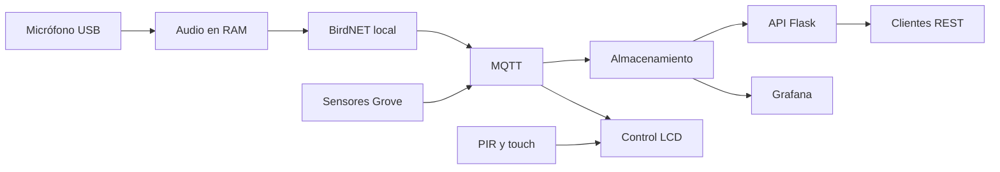

# Txori Kantua

Estación IoT para acercar la naturaleza a las personas mediante el reconocimiento local de cantos de aves y una experiencia interactiva. Proyecto universitario con Raspberry Pi 5; el trabajo representa el **65 % de la asignatura**.

## Estado real

**Fase de planificación y fundamentos, 5 de noviembre de 2026.** Este repositorio contiene la base documental y el backlog. No existe todavía una implementación del sistema, ni evidencia de disponibilidad, conexión o prueba del hardware. BirdNET, MQTT, Flask, InfluxDB y Grafana son tecnologías propuestas pendientes de validación. No hay release del MVP.

- [Tablero de desarrollo](https://github.com/users/elenaatorralbo/projects/2)
- [Product Backlog](https://github.com/elenaatorralbo/txori-kantua/issues)
- [Milestones oficiales](https://github.com/elenaatorralbo/txori-kantua/milestones)

## MVP previsto

- Capturar ventanas cortas de audio en memoria y reconocer aves localmente con BirdNET.
- Publicar eventos de detección y lecturas de temperatura, humedad, presión e iluminación.
- Almacenar observaciones y visualizar especies, tendencias y estado de la Raspberry Pi.
- Activar una pantalla LCD con PIR o touch, mostrar información ES/EU/EN y apagarla tras 20 segundos de inactividad.
- Recuperarse de reinicios y fallos de conexión con comportamiento documentado.

**Privacidad:** no almacenar conversaciones ni transmitir audio bruto. El sistema solo persiste metadatos de detección y observaciones ambientales. Véase [privacidad](docs/privacy.md).

Grafana consultará el almacenamiento mediante su fuente de datos; la API ofrece otra interfaz de lectura. No se presupone que Grafana consuma directamente Flask. La elección final se registra en un ADR.

## Calendario oficial

| Sprint | Fechas de 2026 | Resultado esperado |
|---|---|---|
| 1 — Foundations | 3–17 noviembre | Backlog, arquitectura y pruebas reales de sensores/actuadores |
| 2 — Working Pipeline | 17 noviembre–3 diciembre | Demostración sensor → procesamiento → almacenamiento → visualización |
| 3 — MVP Release | 3–11 diciembre | MVP integrado, probado, documentado y entregado |

Demostración final: semana del 14 de diciembre. El calendario anterior de cinco sprints queda sustituido por estos tres. La release `v1.0.0` solo se publicará tras aceptación verificable del MVP.

## Tecnologías y decisiones

Python y Raspberry Pi OS como base propuesta; BirdNET para inferencia; Mosquitto/MQTT y JSON para eventos; Flask/OpenAPI para lectura; InfluxDB y Grafana para series y paneles. SQLite se evaluará para eventos e idempotencia. Docker se utilizará únicamente donde simplifique despliegue y se valide en ARM64. Euskalmet y las demás ampliaciones quedan fuera del MVP.

## Instalación prevista

Todavía no hay aplicación ejecutable, dependencias fijadas, imágenes Docker ni servicios instalables. No se ofrecen comandos ficticios de arranque. El orden de preparación es inventariar hardware, validar privacidad de captura, preparar Raspberry Pi OS y Python, probar buses/periféricos y decidir versiones mediante mediciones. Las instrucciones reproducibles se incorporarán en las issues de provisión y despliegue.

## Documentación

- [Arquitectura y estructura futura](docs/architecture.md) · [Decisiones técnicas](docs/decisions.md)
- [Hardware y evidencia de pruebas](docs/hardware.md)
- [SCRUM y responsabilidades](docs/scrum.md) · [Roadmap](docs/roadmap.md) · [Backlog indexado](docs/backlog.md)
- [MQTT y JSON](docs/mqtt.md) · [API REST](docs/api.md)
- [Privacidad](docs/privacy.md) · [Validación del MVP](docs/acceptance.md)
- [Configuración de GitHub y Wiki](docs/github-management.md)
- [Cómo contribuir](CONTRIBUTING.md)

El equipo original incluye a David Fernández, Javier Santamaría, Elena Torralbo y Erik Eguskiza. **Elena confirmó el grupo de cuatro el 06/11/2026.** Se conserva esta confirmación del equipo; no se atribuye una aprobación documental al profesor. Javier está identificado como `javiers2004`, con invitación al repositorio pendiente de aceptar.
