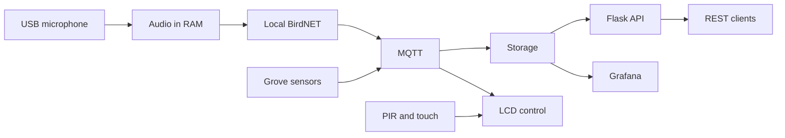

# Txori Kantua

IoT station that brings nature closer to people through local recognition of bird songs and an interactive experience. University project on a Raspberry Pi 5; the work accounts for **65 % of the course grade**.

## Actual status

**Planning and foundations phase, 5 November 2026.** This repository contains the documentation baseline and the backlog. There is no implementation of the system yet, nor any evidence of hardware availability, connection or testing. BirdNET, MQTT, Flask, InfluxDB and Grafana are proposed technologies pending validation. There is no MVP release.

- [Development board](https://github.com/users/elenaatorralbo/projects/2)
- [Product Backlog](https://github.com/elenaatorralbo/txori-kantua/issues)
- [Official milestones](https://github.com/elenaatorralbo/txori-kantua/milestones)

## Planned MVP

- Capture short audio windows in memory and recognise birds locally with BirdNET.
- Publish detection events and temperature, humidity, pressure and light readings.
- Store observations and display species, trends and Raspberry Pi status.
- Turn on an LCD screen with PIR or touch, show information in ES/EU/EN and switch it off after 20 seconds of inactivity.
- Recover from reboots and connection failures with documented behaviour.

**Privacy:** do not store conversations or transmit raw audio. The system only persists detection metadata and environmental observations. See [privacy](docs/privacy.md).

Grafana will query storage through its data source; the API offers another read interface. It is not assumed that Grafana consumes Flask directly. The final choice is recorded in an ADR.

## Official schedule

| Sprint | 2026 dates | Expected outcome |
|---|---|---|
| 1 — Foundations | 3–17 November | Backlog, architecture and real sensor/actuator tests |
| 2 — Working Pipeline | 17 November–3 December | Demonstration sensor → processing → storage → visualisation |
| 3 — MVP Release | 3–11 December | Integrated, tested, documented and delivered MVP |

Final demonstration: week of 14 December. The earlier five-sprint schedule is replaced by these three. Release `v1.0.0` will only be published after verifiable acceptance of the MVP.

## Technologies and decisions

Python and Raspberry Pi OS as the proposed base; BirdNET for inference; Mosquitto/MQTT and JSON for events; Flask/OpenAPI for reads; InfluxDB and Grafana for series and dashboards. SQLite will be evaluated for events and idempotency. Docker will only be used where it simplifies deployment and is validated on ARM64. Euskalmet and the other extensions are outside the MVP.

## Planned installation

There is no executable application, pinned dependencies, Docker images or installable services yet. No fictitious start commands are offered. The preparation order is: inventory hardware, validate capture privacy, prepare Raspberry Pi OS and Python, test buses/peripherals and decide versions through measurements. Reproducible instructions will be added in the provisioning and deployment issues.

## Documentation

- [Architecture and future structure](docs/architecture.md) · [Technical decisions](docs/decisions.md) · [ADR](docs/adr/README.md)
- [MVP scope](docs/mvp-scope.md) · [Interface registry](docs/interfaces.md)
- [Hardware and test evidence](docs/hardware.md) · [Raspberry Pi provisioning and Python environment](docs/provisioning.md)
- [SCRUM and responsibilities](docs/scrum.md) · [Roadmap](docs/roadmap.md) · [Indexed backlog](docs/backlog.md)
- [MQTT and JSON](docs/mqtt.md) · [Mosquitto broker](docs/broker.md) · [REST API](docs/api.md) · [Executable contracts](contracts/README.md)
- [Privacy](docs/privacy.md) · [MVP validation](docs/acceptance.md)
- [GitHub and Wiki configuration](docs/github-management.md)
- [How to contribute](CONTRIBUTING.md)

The original team includes David Fernández, Javier Santamaría, Elena Torralbo and Erik Eguskiza. **Elena confirmed the group of four on 06/11/2026.** This team confirmation is kept; no documentary approval is attributed to the lecturer. Javier is identified as `javiers2004`, with access and assignment of his ten issues verified on 06/11/2026.
