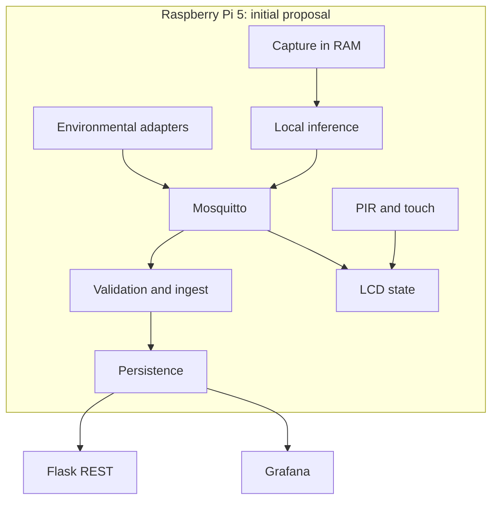

# Proposed architecture

Status: initial design subject to review in Sprint 1; it does not describe services that are already deployed.

## Components and boundaries

| Planned component | Responsibility | Interface | Proposed owner |
|---|---|---|---|
| Audio capture | Windows in RAM, bounded queue, explicit discard | Validated model input | David |
| Inference | BirdNET, temporal/geographic and confidence filter | JSON events v1 | David |
| Environmental reading | Per-model adapters, units and quality | MQTT v1 | Elena, supported by Javier |
| Broker | Transport, authentication and ACL | MQTT | Javier |
| Ingest | Validation, deduplication and persistence | MQTT → databases | Javier |
| API | Bounded queries and consistent errors | REST/OpenAPI | Javier |
| Dashboard | Species, environment, trends and health | Grafana data source | Erik |
| Station | State machine, name catalogue and expiry | MQTT + PIR/touch → LCD | Elena |

Everyone reviews the contracts and takes part in integration. No module imports another module's physical drivers: sensor adapters are isolated so that logic can be tested with fixtures.



## Data and source of truth

Proposal to be validated: SQLite for detections and already-processed identifiers; InfluxDB for environment, health and bird-count projections that Grafana can query. Each datum will have a single authoritative source; projections must be rebuildable. A simpler alternative is SQLite with compatible visualisation; another is InfluxDB for everything if sufficient idempotency is demonstrated. Dual writes will not be introduced without a recovery strategy. The decision is closed in [decisions](decisions.md) before implementing persistence.

Grafana reads the approved data source. Flask allows clients to consume the same data; there is no obligation to build an additional web frontend for the MVP. Common names are resolved through a versioned catalogue, never by changing the taxonomic identifier of the event.

## Reliability and resources

- `event_id` identifies a logical observation and is kept across retries. QoS 1 implies possible duplicates, not exactly-once.
- Observation and reception times are separate; storage in UTC, presentation in Europe/Madrid.
- Audio with a bounded queue; if inference falls behind, windows are discarded and a metric is incremented. An audio spool is never created.
- Bounded metadata queues, backoff and an explicit loss policy. The dashboard distinguishes old data from current data.
- Unprivileged processes; broker, databases and Grafana are not publicly exposed by default. Credentials outside the repository.
- CPU, RAM, temperature and latency are measured on the Pi 5 before accepting the sampling rate or deploying all services on the same device. Storage/dashboards can be moved to a machine on the network; audio and inference stay local.

## Future code structure

Directories will be created when their first real implementation is added, without empty modules:

```text
src/txori_kantua/
  audio/          # capture and inference
  sensors/        # environmental adapters and inputs
  messaging/      # contracts and MQTT
  storage/        # ingest and repositories
  api/            # Flask
  station/        # interaction states and LCD
tests/            # unit, contract and integration
contracts/        # verified JSON Schema and OpenAPI
deploy/           # systemd and, if applicable, Docker
dashboards/       # reproducible exports
docs/             # design, operations and evidence without audio
```

## Risks and exit decisions

| Risk | Early check | Response |
|---|---|---|
| Missing/incompatible hardware | Inventory and Hat test in Sprint 1 | Validated replacement; do not fake a physical test with a simulator |
| Slow or incompatible BirdNET | Sprint 1 benchmark | Adjust windows/model/configuration; limit frequency and record losses |
| Pi overload | Sustained measurement with all services | Move data/dashboard to the local network without moving audio |
| Unreadable LCD names | Character test in Sprint 1 | Transliteration/pagination, scientific-name fallback |
| Insufficient team capacity | Confirmation with lecturer and planning | Cut optional items first; renegotiate mandatory scope with evidence |
