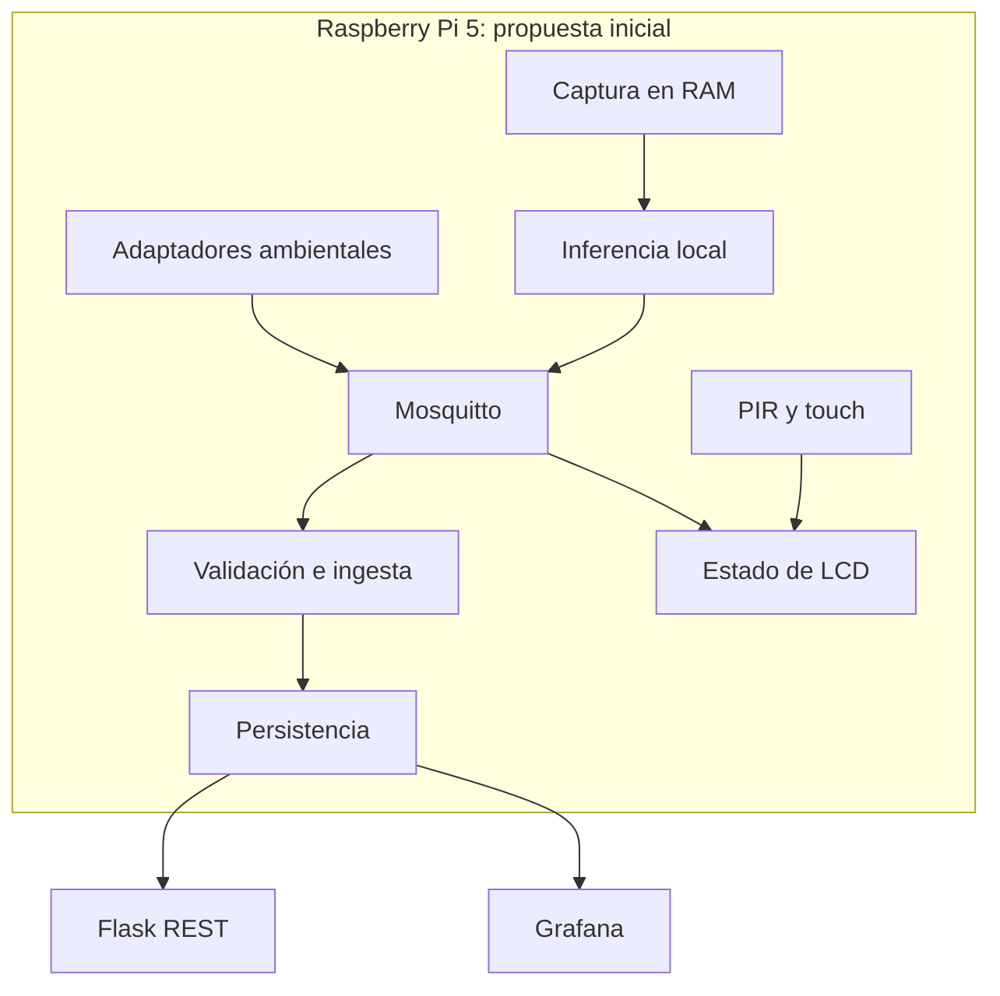

# Arquitectura propuesta

Estado: diseño inicial sujeto a revisión en Sprint 1; no describe servicios ya desplegados.

## Componentes y límites

| Componente previsto | Responsabilidad | Interfaz | Responsable propuesto |
|---|---|---|---|
| Captura de audio | Ventanas en RAM, cola acotada, descarte explícito | Entrada de modelo validada | David |
| Inferencia | BirdNET, filtro temporal/geográfico y confianza | Eventos JSON v1 | David |
| Lectura ambiental | Adaptadores por modelo, unidades y calidad | MQTT v1 | Elena, apoyo Javier |
| Broker | Transporte, autenticación y ACL | MQTT | Javier |
| Ingesta | Validación, deduplicación y persistencia | MQTT → bases de datos | Javier |
| API | Consultas limitadas y errores consistentes | REST/OpenAPI | Javier |
| Dashboard | Especies, ambiente, tendencias y salud | Fuente de datos de Grafana | Erik |
| Estación | Máquina de estados, catálogo de nombres y caducidad | MQTT + PIR/touch → LCD | Elena |

Todos revisan los contratos e intervienen en integración. Ningún módulo importa drivers físicos de otro: los adaptadores de sensores se aíslan para poder probar lógica con fixtures.



## Datos y fuente de verdad

Propuesta a validar: SQLite para detecciones e identificadores ya procesados; InfluxDB para ambiente, salud y proyecciones de conteos de aves que Grafana pueda consultar. Cada dato tendrá una única fuente autoritativa; las proyecciones deberán poder reconstruirse. Una alternativa más simple es SQLite con visualización compatible; otra es InfluxDB para todo si se demuestra idempotencia suficiente. No se introducirá doble escritura sin estrategia de recuperación. La decisión se cierra en [decisiones](decisions.md) antes de implementar persistencia.

Grafana lee la fuente de datos aprobada. Flask permite consumir los mismos datos desde clientes; no hay obligación de construir un frontend web adicional para el MVP. Los nombres comunes se resuelven mediante catálogo versionado, nunca cambiando el identificador taxonómico del evento.

## Fiabilidad y recursos

- `event_id` identifica una observación lógica y se conserva al reintentar. QoS 1 implica posibles duplicados, no exactly-once.
- Tiempos de observación y recepción se separan; almacenamiento UTC, presentación Europe/Madrid.
- Audio con cola limitada; si inferencia se retrasa, se descartan ventanas y se incrementa una métrica. Nunca se crea un spool de audio.
- Colas de metadatos limitadas, backoff y política de pérdida explícita. El dashboard distingue datos antiguos de datos actuales.
- Procesos sin privilegios; broker, bases y Grafana no se exponen públicamente por defecto. Credenciales externas al repositorio.
- CPU, RAM, temperatura y latencia se miden en Pi 5 antes de aceptar frecuencia de muestreo o despliegue de todos los servicios en el mismo dispositivo. Se puede mover almacenamiento/paneles a un equipo de la red; el audio y la inferencia siguen locales.

## Estructura futura del código

Se crearán directorios al incorporar su primera implementación real, sin módulos vacíos:

```text
src/txori_kantua/
  audio/          # captura e inferencia
  sensors/        # adaptadores ambientales y entradas
  messaging/      # contratos y MQTT
  storage/        # ingesta y repositorios
  api/            # Flask
  station/        # estados de interacción y LCD
tests/            # unitarias, contratos e integración
contracts/        # JSON Schema y OpenAPI verificados
deploy/           # systemd y, si procede, Docker
dashboards/       # exportaciones reproducibles
docs/             # diseño, operación y evidencias sin audio
```

## Riesgos y decisiones de salida

| Riesgo | Comprobación temprana | Respuesta |
|---|---|---|
| Hardware ausente/incompatible | Inventario y prueba del Hat en Sprint 1 | Sustitución validada; no fingir prueba física con simulador |
| BirdNET lento o incompatible | Benchmark de Sprint 1 | Ajustar ventanas/modelo/configuración; limitar frecuencia y registrar pérdidas |
| Sobrecarga de Pi | Medición sostenida con todos los servicios | Mover datos/dashboard a red local sin mover audio |
| Nombres LCD ilegibles | Prueba de caracteres en Sprint 1 | Transliteración/paginación, fallback científico |
| Capacidad de equipo insuficiente | Confirmación con profesor y planning | Recortar opcionales primero; renegociar alcance obligatorio con evidencia |
